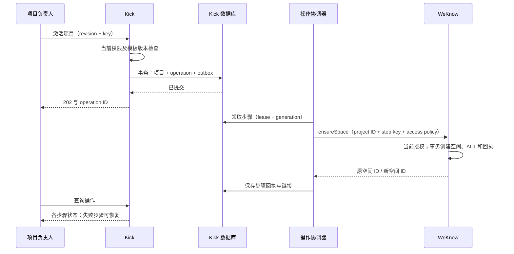

# 扩展与服务契约草案

状态：RFC 0.1，设计示例，不是当前已实现 API。基线与范围见 [主方案](README.md)。示例中 `example.test` 和合成 ID 不指向真实部署；示例省略的字段不能直接作为完整生产配置。

## 1. 契约分层

| 层 | 约束 | 不能承担的责任 |
| --- | --- | --- |
| 应用清单 | 版本、依赖、能力、权限声明、存储和启停 | 不自动授予这些权限 |
| 资源契约 | 稳定身份、归属、revision、关系 | 不复制所有业务数据 |
| 命令契约 | 输入、执行身份、当前授权、幂等、预期版本 | 不把重试等同于再次执行 |
| 事件契约 | 已提交事实、来源、版本、关联 | 不作为调用授权或有序传输保证 |
| 投影接口 | 搜索、待办、通知、活动、项目卡片 | 不成为业务权威 |
| 生命周期 | 安装、校验、启用、排空、停用、升级、保留数据 | 不允许应用自授高权或执行任意核心迁移 |

稳定身份、错误模型和操作查询先统一；具体业务字段继续由应用维护。契约只覆盖确实需要的交互，避免引入万能对象和任意动作接口。

## 2. 扩展类别与信任边界

1. **内置模块**：由套件构建并审查，按模块注册。Kick 是首个内置模块。
2. **业务服务适配**：Makit / WeKnow 保留服务，使用同一清单及能力协议。
3. **连接器**：连接外部代码、身份、消息等服务。限制凭据、目标、事件和动作。
4. **第三方扩展服务**：独立进程 / 容器、独立主体、独立存储、受限网络。第一版不向其开放宿主卷或 Docker socket。

同进程代码都处在同一信任边界，不能靠 TypeScript 接口把恶意插件“沙箱化”。未经审查的第三方代码不得加载进核心进程。外部扩展不能持有其他应用的数据库凭据或平台会话签名密钥。

前端只接受平台渲染的结构化卡片 / 列表和允许的深链。完整第三方 UI 使用独立来源跳转，第一版不做任意远程 JavaScript 注入或通用 iframe SDK。

## 3. 应用清单

下面是未来参考扩展 `org.example.quality` 的设计片段。该扩展只保存检查结果，不拥有 Makit 的发布状态，也不自动部署。

```json
{
  "manifestVersion": "0.1",
  "id": "org.example.quality",
  "version": "0.1.0",
  "kind": "service-extension",
  "compatibility": {
    "coreContract": "0.1",
    "resourceContract": "0.1",
    "eventContracts": ["cobuild.delivery.accepted.v1"]
  },
  "dependencies": [{"id": "makit", "required": true}],
  "capabilities": ["project.card", "search.provider", "todo.provider"],
  "permissions": [
    {"action": "quality.check.read", "resourceType": "quality.check"},
    {"action": "quality.check.record", "resourceType": "quality.check"}
  ],
  "events": {
    "consumes": ["cobuild.delivery.accepted.v1"],
    "produces": ["org.example.quality.check.recorded.v1"]
  },
  "ui": {
    "contributions": [{"slot": "project.summary", "component": "status-list", "provider": "checks"}]
  },
  "storage": {"owner": "org.example.quality", "schemaVersion": 1, "exportContract": "0.1"},
  "lifecycle": {"disable": "drain", "dataOnDisable": "retain"},
  "configurationSchema": "schemas/config.json"
}
```

安装配置另存：固定镜像 digest、允许的 endpoint / egress、能力授权、密钥引用、启用范围和资源限额。不能由下载来的清单自行决定网络放行、卷挂载或核心权限。

验证器必须拒绝：未知必填字段、重复应用 ID、权限命名冲突、未注册动作、循环依赖、不兼容契约、额外核心存储访问、任意脚本表达式和未经批准的 UI 来源。Schema 文件必须在包内，不能在校验时远程加载任意 `$ref`。

清单声明是开发者的请求；管理员安装批准后得到受限 grant，运行时仍检查主体、资源和当前状态。

## 4. 资源与关联

```json
{
  "organizationId": "00000000-0000-4000-8000-000000000001",
  "appId": "makit",
  "type": "work-item",
  "id": "00000000-0000-4000-8000-000000000101"
}
```

`ResourceRef` 不包含可变名字或 URL；显示信息通过有权的 `resolve` 获取。每个资源有 `revision` 和 owner。跨实例导入需显式映射实例与资源 ID，不能把同名自动当成同一资源。

| 关系 | 例子 | 约束 |
| --- | --- | --- |
| `documents` | 文档说明某需求 | 两端均有权才能显示对方标题 |
| `implements` | PR 实现工作项 | 仓库 / PR 原生 ID 和提供方安装 ID 显式绑定 |
| `blocks` | 工作项阻塞另一工作项 | 禁止自环；递归查询有界；有向依赖环给出可理解错误 |
| `delivers` | 交付包含工作项 | 固定交付快照，不能随分支漂移 |
| `supersedes` | 新决策替代旧决策 | 保留原决策，不覆盖历史 |

业务关系由其所属应用维护；平台只保存通用关系的轻量引用。删除 / 撤权时可保留受限的审计引用，不返回不可见标题、摘要或外部 URL。每次跳转仍由目标应用检查权限。

## 5. 命令、授权与结果

设计形式：命令发送到资源所属服务的已注册 action。平台聚合 API 和 MCP 都调用该处理器，不各写一份业务逻辑。

```json
{
  "action": "kick.project.rename",
  "resource": {
    "organizationId": "00000000-0000-4000-8000-000000000001",
    "appId": "kick",
    "type": "project",
    "id": "00000000-0000-4000-8000-000000000201"
  },
  "expectedRevision": 7,
  "idempotencyKey": "7d3f688f-f43a-4259-992b-bb23f40d541f",
  "input": {"name": "示例项目二期"}
}
```

客户端不能在请求体里自行指定已认证 actor。服务从 Cookie、受限令牌或验证后的服务委托中恢复真实上下文：`actorId`、服务主体、组织、授权范围、策略版本、关联 ID。来自事件的 actor 字段仅供追溯，不用于直接授权。

处理顺序：

1. 验证调用身份、应用状态、内容大小和 action schema。
2. 查同组织 / action / 资源 / 主体范围内的幂等记录。
3. 同 key、同输入摘要返回原 operation；同 key 不同输入返回冲突，不能当新请求运行。
4. 读取当前成员状态、项目资格和原生业务权限；读取预期 revision。
5. 在资源所属数据库的同一事务内写业务变更、操作结果与 outbox。
6. 后台推进后续步骤；读取 operation 时仍做权限检查。

当前平台身份和业务存在不同数据库，不能假装跨库事务原子。业务事务中的 outbox 跟业务同库；身份校验返回有版本的许可，并在关键提交 / 外发前复核。不能用短期缓存的角色永久授权长期任务。

项目中可预期的角色撤销并发，通过策略版本 / fencing 和受管资源的当前授权实现；外部提供方已经接受的动作不能承诺撤回。界面必须区分“取消未执行步骤”和“撤销已完成副作用”。

并发边界必须在实现阶段明确：权限撤销确认后的新请求按新权限处理；撤销前已经提交的事务属于历史事实，不反向改写。需要严格提交顺序的高风险核心动作使用协调屏障 / 受管写入许可，不能仅靠“先查一次权限再提交”宣称跨数据库零竞争窗口。长连接的最大撤销延迟单独实测和公布。

| HTTP / 业务结果 | 语义 | 客户端行为 |
| --- | --- | --- |
| 200 / 201 | 当前命令已完成 | 展示最新 revision |
| 202 + operation ID | 已持久接收，存在后续步骤 | 查询 / 订阅操作，不重复创建 |
| 401 / 403 | 身份失效 / 当前无权 | 恢复身份或说明权限，不自动提权 |
| 404 | 不存在或不可披露 | 不暴露资源名称 |
| 409 | 输入幂等冲突、业务状态冲突、资源关联冲突 | 展示可解决冲突 |
| 412 / 428 | 预期版本不符 / 缺少前置版本 | 重新读取并显式确认 |
| 422 | 参数或能力不支持 | 就地修正输入 |
| 429 | 限流 | 遵循 Retry-After；沿用原操作标识 |
| 503 | 依赖或当前授权无法确认 | 显示临时不可用，不能用旧权限放行 |

统一错误体包括 `code`、可读消息、`correlationId`、可安全公开的 `retryAfter` / `operationId`。不输出堆栈、密钥、未经授权的资源详情。

## 6. 持久操作与事件

Operation 状态：`queued → running → succeeded`，也可进入 `retry_wait`、`blocked`、`unknown` 或 `cancelled`。一个操作包含有稳定 ID 的步骤。已完成步骤保留回执，重试不重置整个流程。

外部调用返回不明时进入 `unknown`：先使用外部幂等键、回执或查询核对；不能确认且提供方不支持幂等时交给管理员处理。不得自动生成新幂等键再次发送。

```json
{
  "specversion": "1.0",
  "id": "00000000-0000-4000-8000-000000000301",
  "source": "urn:cobuild:installation:example:kick",
  "type": "cobuild.project.activated.v1",
  "subject": "projects/00000000-0000-4000-8000-000000000201",
  "time": "2026-10-28T08:00:00Z",
  "datacontenttype": "application/json",
  "orgid": "00000000-0000-4000-8000-000000000001",
  "projectid": "00000000-0000-4000-8000-000000000201",
  "correlationid": "00000000-0000-4000-8000-000000000401",
  "data": {"projectRevision": 8, "operationId": "00000000-0000-4000-8000-000000000501"}
}
```

事件信封参考 [CloudEvents v1.0.2](https://github.com/cloudevents/spec/blob/v1.0.2/cloudevents/spec.md)。自定义扩展字段使用小写；业务版本在 type / payload schema 中维护，不能把 `specversion` 当成业务 schema 版本。

可靠性约束：

- outbox 跟来源业务写入同事务；SQLite 与 PostgreSQL 分别实现存储适配。
- 第一版通过受控 HTTP 投递。接收方校验来源和 schema 后持久写 inbox，再确认收到；消费者按 `source + id + consumer` 防重。
- 消费者的本地业务结果与 inbox 完成状态同事务；跨服务动作再使用稳定 command key。承诺至少一次投递，不承诺跨外部系统 exactly-once。
- 按资源 revision 处理旧事件；遇到版本缺口拉取权威快照或等待补齐，不依赖不同资源间的全局顺序。
- 租约附 generation / fencing token；过期 worker 不能提交本地完成状态。接收命令的核心服务也校验当前 generation。
- 事件包含引用和必要事实，不广播完整文档、邮件正文、个人敏感字段或令牌。订阅范围必须获批；处理时再鉴权读取内容。
- 认证后的生产者只能使用自己获准的 `source` 和事件 type 命名空间；不能通过在 payload 填入 `kick` 就冒充核心事件。接收方同时检查 schema、安装主体和订阅授权。
- 事件保留、死信、已处理回执和防重记录分别配置；幂等 / 外部副作用回执至少覆盖可重投与备份恢复窗口。超出支持窗口不自动重投。
- 定时对账修复漏事件和投影；schema 破坏性变更新 type 版本，旧消费者明确拒绝，而非静默丢字段。



## 7. 权限接口与身份

基础接口形态为 `authorize(actor, action, resource)` 及同资源域的 `batchAuthorize`。来源服务维护业务判断；平台提供当前组织和项目资格。对外只暴露调用者有权知道的拒绝理由。

项目权限和应用权限不能互相替代。扩展安装管理员只能授予自己有权配置的范围，不能冒充普通用户调用业务；服务主体的动作需有显式 grant。用户发起的异步动作保留发起者与委托范围，重试时验证有效性。

新协议引入版本 / audience / key ID / request ID，并持久防重。当前 HMAC 时间窗只验证请求有效时间，不能被描述成完整 replay 防护；`packages/service/channel.mjs` 应通过 v2 适配渐进升级，v1 仅保留在明确兼容窗口内的内置调用，不能复用于未审查的扩展。

v2 签名绑定 method、精确 path、规范化 body 摘要、时间、request ID、audience 与 key ID；对应传输保持 HTTPS 或受控本机后端通道，不在重定向后重放签名。调用者主体来自验签 / 令牌结果，不接受未验证的身份请求头。加密和 OIDC 使用成熟实现，不自创新算法。

Cookie 仍 host-only、HttpOnly；HTTPS 下 Secure。浏览器之间不交换长期令牌。OIDC 通过成熟库验证 issuer、audience、state、nonce、PKCE 和回调；账号映射不按邮箱自动合并。平台服务认证与外部用户身份协议分开。

## 8. 搜索、待办、通知与 UI 接口

| 接口 | 输入与输出 | 必要约束 |
| --- | --- | --- |
| `resolveResources` | refs → 有权的名称、类型、深链、revision | 不返回无权资源的存在性信息 |
| `search` | 用户上下文、查询、项目过滤、cursor → 分页结果 | 来源鉴权，固定最大条数，超时，来源级 cursor |
| `listTodos` | 用户与范围 → 来源引用、待办类型、状态、动作 | 使用来源 ID 去重，不能用显示文本作 key |
| `projectSummary` | project ID → 结构化卡片 | 数据范围受权威权限控制；不能注入 HTML |
| `notify` | 原始业务事件、接收对象规则、模板版本 | 接收人权限复查、去重、偏好和通道选择 |

全部接口输出明确 `fetchedAt` 和来源状态；过期投影仅可在权限仍可确认时显示并标注。返回结果必须有条数、响应体大小与 deadline 上限；一个 provider 失败不能令整个工作台空白。

搜索第一版分来源显示数量与“还有更多”，不先取前十条再当全量排序。请求时撤权、索引撤权前的内容、旧缓存和统计计数均需验收。

UI slot 第一版仅允许 `project.summary`、`project.activity`、`workbench.todo`、`global.search` 和受控应用深链。贡献内容的按钮映射到注册 action；后端仍鉴权。不能注册覆盖核心身份页或隐藏必需的退出与安全入口。

## 9. 轻量工作流、模板与字段

一个模板包含版本、适用对象、默认状态流、有限字段、初始化文档和自动化规则引用。实例保存模板版本；升级先生成差异预览，对已存在状态和必填字段有迁移映射。

基础工作项字段类型限定为短文本、长文本、单选、多选、日期、数字、成员、资源引用。schema 由应用拥有，字段名称不能覆盖内部权限 / revision / ID。删除字段先停用和导出，不能直接清除存量。第一版不支持公式执行、远程表达式或自定义脚本。

自动化实例保存 `ruleVersion`、触发事件 ID、作用域、执行主体、步骤键、重试策略与外发许可。模拟运行不外发、不写业务数据；结果列出将调用的动作和权限缺口。规则激活需要静态检查环路，运行时另有限深与次数预算，不能只靠静态检查保证不循环。

审批和高风险动作的确认绑定输入摘要、目标资源 revision、执行范围与过期时间；输入或权限变化后需要重新确认。MCP / AI 和网页使用同一确认语义。

## 10. 模块生命周期

安装状态与运行健康分开：

- 生命周期：`installed_disabled → enabling → enabled → draining → installed_disabled`。
- 健康：`healthy / degraded / unavailable`；单个连接器故障不能让核心模块自动被卸载。
- 迁移作为受控管理操作单独记录，进行中禁止不兼容应用启动。

| 操作 | 规则 |
| --- | --- |
| 安装 | 检查清单、来源、兼容、权限和私有存储；不自动启用外发 |
| 启用 | 配置和迁移通过后开启路由、API、MCP、订阅与 worker；最后显示可用 |
| 停用 | 先拒绝新写入和新外发、停止入队，再排空 / 冻结已领取步骤；保留数据 |
| 依赖停用 | 默认拒绝破坏性级联，显示受影响模块；管理员可提交有序停用计划 |
| 取消步骤 | 尚未外发的取消；已接受 / 不明结果进入对账，不显示“从未执行” |
| 恢复启用 | 原 ID 和回执继续使用；核对 stale / unknown，不盲目补发历史通知 |
| 卸载 | 保留导出和重新安装元数据；删除业务数据是独立高风险操作 |

已接受的外部请求无法保证因停用而撤回。若存在未核对的外发，界面显示“已停止新动作，存在待核对操作”，不能给出无条件“全部停止”的结论。

配置分三类：部署静态配置、业务版本化配置、私有凭据。静态端口 / origin / 存储改变需重启；业务规则可发布新版本；密钥轮换需有明确版本和过渡策略。不要让环境变量和数据库字段互相覆盖而无法解释最终值。

## 11. SDK、协议版本和兼容

建议新增目录（本轮仅设计）：

```text
packages/contracts/          JSON Schema、OpenAPI、资源 / 事件 / 错误类型
packages/extension-sdk/      认证、命令客户端、生命周期适配与契约测试
packages/ui-contract/        设计令牌、slot schema、导航与深链
apps/platform/modules/      逐步拆出的内置模块
extensions/                 审查后可独立安装的示例 / 扩展
connectors/                 代码、身份与消息适配
tests/contracts/            提供方 / 消费者兼容、故障和权限测试
```

将来可以提供 `extension validate`、`contract test` 和 `doctor` 命令；这些是待实现工具名，不是现在能执行的命令。

alpha 阶段按精确契约版本和 release manifest 验证，不承诺任意 semver 自动兼容。稳定 v1 后才承诺明确的向后兼容窗口；未知字段只能按 schema 规则处理，不能让旧应用读坏新数据。

SDK 提供类型、认证中间件、错误与重试基础，不包含替业务决定权限的默认高权凭据。协议可被非 JavaScript 服务实现。Makit / WeKnow 适配与第三方示例使用同一套契约测试。

## 12. 外部连接器与恢复

连接器须声明所需 API 权限、支持事件、读写动作、提供方 API 版本范围与核对能力。端点由部署管理员设置；自托管私网地址可显式批准，但必须防止重定向 / DNS 变化绕过批准范围。普通内容中的 URL 不自动成为允许的请求地址。

Git Webhook 验签后持久接收，禁止仅收到 HTTP 就标记业务完成。关联映射包含 provider installation、repository ID、PR ID、commit SHA 与 environment；branch name 不作为不可变证据。

隔离恢复默认禁止外发和后台定时副作用。先核对 operation、outbox、inbox、防重回执和外部状态，再恢复消费者。历史快照回滚导致的旧事件不能凭数据库里“未发送”就再次发出。

扩展需要给出导出 / 导入格式、备份一致性要求和版本兼容。第一版只承诺经过演练的组合，不把服务接口稳定等同于数据库可以任意降级。
