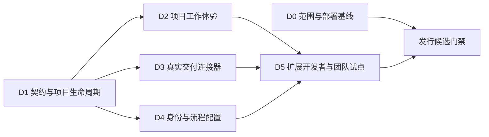

# 实施、迁移与验收计划

状态：分批实施中，首批进度见 [实施记录](IMPLEMENTATION-01.md)。该计划不授权触碰现网，也不把当前发行阻塞标记为完成。主线见 [方案](README.md)，协议见 [契约](CONTRACTS.md)。

## 1. 实施原则

1. 以本地自部署分支为改造对象；不直接从实验室服务复制真实数据或凭据。
2. 每个阶段提交可评审增量，包含源码、配置迁移、测试、使用说明和证据；再自行 review。
3. 不把一次重构变成全栈重写。先给现有服务加适配，再替换旧入口；避免双写业务主表。
4. 数据迁移先扫描与 dry-run，再在副本演练；不按姓名 / 邮箱 / 项目名猜测关系。
5. 旧版本应用回退必须受 schema 兼容矩阵约束；不能以恢复旧数据库覆盖新写入。
6. 图表、计划、样例和 mock 不替代真实浏览器、外部连接器、恢复或用户验收。

## 2. 现有实现与改造落点

以下路径相对仓库根目录。表中“改造”全部是后续计划。

| 当前位置 | 已有价值 | 渐进改造 |
| --- | --- | --- |
| `suite.json` | 模块、依赖、数据归属清单 | 加契约 / 能力元数据，区分发行模块与原始源码保留 |
| `packages/config/index.mjs` | 配置验证 | 新清单 / capability 校验，严格静态与业务配置边界 |
| `packages/config/runtime.mjs` | 路由、MCP、任务模块门禁 | 从显式注册表生成门禁；未知模块默认拒绝 |
| `packages/service/channel.mjs` | 服务密钥、HMAC、时间窗、请求大小限制 | 版本化 v2 通信、独立 audience、持久请求防重及双版本迁移 |
| `apps/platform/server/suite-auth-store.mjs` | 本地身份与会话 | provider adapter、绑定记录、MFA / OIDC 扩展与恢复 |
| `apps/platform/server/suite-identity.mjs` | 原生跨应用身份桥接 | 作为当前内置协议适配，避免扩大为通用 IdP |
| `apps/platform/server/workspace-store.mjs` | 项目 / 里程碑 / revision / 审计 | 项目策略版本、生命周期、业务事务 outbox |
| `apps/platform/server/project-catalog-store.mjs` | 需求分类与项目关联 | 保留已认领 ID；清理仅显示名关联的歧义，不重新建项目 |
| `apps/platform/server/project-knowledge-store.mjs` | 持久建空间任务、租约和回执 | 通用 operation adapter、受管 / 既有空间模式 |
| `apps/platform/server/project-action-bridge.mjs` | Makit 回写项目动作 | 注册型命令与统一错误模型；不绕过当前授权 |
| `apps/makit/server/common/selfhost/` | 本地身份、目录、存储适配 | 核心契约提供方；不回落到飞书数据库 |
| `apps/makit/server/modules/pull-requests/` | GitHub 同步与 Webhook 源码 | provider adapter，首个真实只读交付连接器 |
| `apps/makit/server/modules/notifications/` | 通知状态、失败重试、超时业务逻辑 | 区分原业务事件、站内通知和外发投递 |
| `apps/makit/shared/operations-insights.interface.ts` | 阶段耗时、阻塞、返工、完整性 | 复用数据模型与来源证据，避免重新造统计口径 |
| `integrations/weknow/source/apps/server/src/core/auth/feishu/suite-collaboration.service.ts` | 目录、空间创建与项目回执 | 新受管空间事务 ACL、资源查询 / 搜索 / 全路径授权适配 |
| `deploy/suite.py`、`deploy/ingress.py` | 安装、冷备份、恢复、迁移、TLS | 运输 / 新环境演练、恢复外发隔离、扩展兼容与镜像验证 |
| `release-blockers.json` | 未完成发行事项 | 为每项追加证据与范围；不因方案完成而关闭 |

未来目录只是契约方向，不在一开始移动所有文件。每个被替换入口都要保留行为回归及明确的旧接口退出条件。

## 3. 阶段依赖

图表达依赖，不表示现在创建并行运行服务或代理。D1 先形成最小纵切：一个项目命令、一个事件、一个投影和一个权限测试；不先把整个 SDK 做完才接业务。

## 4. D0：收紧范围和可交付基线

**成果**：新的发行 profile 只包含 Platform / Kick / Makit / WeKnow。排除项不再出现在安装向导、应用导航、公开 MCP 清单和依赖构建中。原工程与来源记录保留。

工作包：

- 列出 HiFlow / Evalab / 荣誉及其他非核心代码与公共身份、邮件、UI 的真实依赖；抽出核心使用部分后才排除业务构建。
- 不能直接删除当前共用邮箱身份文件；新身份 / 通知模块先明确所有权，再做 import 替换。
- 完成镜像 digest、备份清单与新目录 / 新环境导入；先同架构，另做 x86_64 构建与恢复验证。
- 平台和 WeKnow 的迁移策略达到与 Makit 相同的审查级别；新增表前必须有备份、兼容和失败中断验证。
- 许可、素材和依赖来源清单持续补齐；公开许可选择独立确认。

**关口 D0-G1**：完全无飞书 / GitHub / 邮件配置可以安装、登录、创建项目和文档；不得发起到实验室域名的请求。

**关口 D0-G2**：另一受支持机器恢复账号、文档附件和未完成操作；备份未被修改，默认不外发。当前同机新目录恢复不能算作跨机器通过。

**关口 D0-G3**：排除模块不进入运行制品；同名路径 / API / MCP 拒绝或明确不支持。原资料没有丢失。

## 5. D1：契约与项目生命周期

**成果**：三个核心应用先遵循新契约；项目改名、归档、成员变化、知识空间权限可追溯。

工作包：

- 引入契约包、ResourceRef、统一错误和 operation 查询；第一个命令选择项目改名。
- outbox 与项目变更同 SQLite 事务；Makit / WeKnow 用各自数据库 inbox。过渡时旧任务由适配器接管，不能两个 worker 同时执行同一业务步骤。
- 将项目 `phase`、归档标志、provisioning 状态分开：立项状态不等于下游应用就绪状态。
- 逐项实现项目改名、受管空间改名、成员变化、项目可见性变化、归档和恢复。
- 新受管空间与 ACL 在同一事务建立；全路径访问守卫先于 UI 上的私有标签上线。
- 受管空间权限与既有空间权限明确区分；旧数据默认 `legacy_shared` 或 `linked_existing`，扫描报告给管理员确认。

**关口 D1-G1**：重复 / 并发命令、网络断开、进程崩溃后，项目与空间仍只有一份明确关联；旧 revision 不覆盖新名字。

**关口 D1-G2**：移除成员后，原生应用直链、搜索、统计、附件、API、MCP 及协作长连接都符合撤销规则。普通项目成员无法借扩展服务身份跨项目操作。

**关口 D1-G3**：归档立即阻止新业务写入和新外发；各下游确认前显示归档处理中。不能用失败回滚删除已有文档。恢复项目时不盲目恢复旧授权或自动重发提醒。

## 6. D2：连贯工作体验

**成果**：全局“我的工作 / 项目 / 知识”，项目内概览、工作项、迭代、交付、知识、活动；站内通知独立于外部消息。

工作包：

- 设计令牌与组件行为规范；先改平台新页面，再让 Makit / WeKnow 逐步一致。
- 平台聚合 API 按真实用户请求来源，不使用管理员抓取所有数据后在前端过滤。
- 统一待办引用和通知偏好；任务完成与通知已读分开。
- 联邦搜索提供来源过滤、项目过滤、分来源分页和局部故障反馈。
- UI 保留列表默认、有效筛选提示、可恢复 URL、空态 / 错误态与稳定预览生命周期。

**关口 D2-G1**：真实浏览器完成“我的工作 → 工作项 → 文档 → 返回”，项目、筛选和编辑草稿保持；无多层重复页头和认证 iframe 依赖。

**关口 D2-G2**：任意单个 provider 超时，只影响自己的卡片 / 结果；未启用能力不给空白入口，后台刷新不关闭预览。

**关口 D2-G3**：键盘完成主链路；焦点、标签、错误提示和对比度通过自动及人工检查。移动端不要求水平拖动整页才能提交。

## 7. D3：真实代码交付

**成果**：首个 GitHub 连接器与 Delivery；后续 GitLab / Forgejo 只通过相同 capability 接口扩展。

工作包：

- 连接器安装选择仓库范围，读取身份、PR、checks、release / deployment 所需最小权限；不默认申请写仓库和自动合并。
- Webhook 持久接收、签名验证、防重、事件解析和定时核对。
- 区分工作项状态、PR 状态、构建 / 测试结果、环境部署状态和业务验收状态。
- Delivery 固定 commit / artifact / environment 以及核验来源；人工证据标记登记者和时间。
- 验收绑定交付 revision；交付变化后需要重新验收。发布说明由 WeKnow 保存草稿，人工确认。

**关口 D3-G1**：专属测试仓库完整完成一次代码变更到交付验收；真实回执存在，明确不触发生产部署或通知其他人。

**关口 D3-G2**：重复、漏发、乱序、force-push、PR reopen、失效权限和外部 API 限流均有准确状态。

**关口 D3-G3**：测试通过但未部署时不能显示已上线；部署了旧版本时不能用新版本的验收记录冒充。

## 8. D4：团队自适应与身份接入

**成果**：OIDC 连接、模板、状态流、有限自定义字段、轻量自动化和连接器控制台。

工作包：

- 接入 OIDC 客户端，保留本地恢复；明确身份关联、组织邀请与组同步的区别。
- 提供目录同步 diff、权限影响预览和失败状态；未完成的全量同步不得执行“删除缺失用户”。
- 模板包含文档 / 状态 / 字段 / 自动化版本。工作项流程保持统一分析阶段映射。
- 规则只使用已注册动作，提供模拟、发布、停用、历史、限流及有权重试。
- MFA、敏感管理动作重新认证、会话和恢复操作纳入同阶段安全验收。

**关口 D4-G1**：不同 issuer 的同邮箱账号不合并；部分目录结果不会删除成员；禁用和恢复不会复活旧会话。

**关口 D4-G2**：模拟规则没有业务副作用；规则循环受限；审批后输入改变或角色撤销阻止执行。

**关口 D4-G3**：模板 v2 发布不修改 v1 项目；用户可看到迁移差异并选择迁移计划。

## 9. D5：扩展开发者与外部试点

**成果**：可复制的扩展开发包、支持矩阵、贡献说明、许可与安全反馈渠道，以及外部团队使用记录。

参考扩展只做“项目检查结果”：拥有自己的检查对象，通过当前项目权限显示摘要；产生待办、搜索结果和活动，不改核心业务状态。

**关口 D5-G1**：开发者只使用文档与 SDK 实现参考扩展，无需修改核心注册分支、身份页或业务数据库。

**关口 D5-G2**：扩展异常不拖垮登录和项目页面；停用后路由 / API / MCP / worker / 新外发均停止。已接受的外部请求保留待核对状态。

**关口 D5-G3**：一次扩展版本升级、一次失败回退和一次备份恢复通过；旧契约不兼容时明确阻止启动，保留数据。

**关口 D5-G4**：外部团队根据文档独立安装并完成自己的项目；记录所有人工帮助、误操作、失败、重复录入和查找成本。没有实际测量前不宣传“效率提升百分之多少”。

## 10. 数据迁移策略

### 10.1 核心记录

- 保持已有组织 / 用户 / 项目 / 文档 ID。为旧动作、角色和关联建立映射表，保留原标识与来源。
- 不用完整数据库重导入来统一名称。已有项目仅补契约元数据；显示名称不作为关联依据。
- 旧 `project_knowledge_space` 回执转入新的步骤模型时保留完成状态、原空间 ID、尝试历史和关联 URL。迁移后只能由一个消费者写该流程。
- 工作项基础字段标准化时保持原需求 / 缺陷语义和历史状态；未知类型留待人工处理，不硬塞默认状态。

### 10.2 空间与权限

先生成只读报告：项目 / 空间关系、Everyone 权限、直接授权、组授权、当前管理员、未知成员和共享空间。报告不得在无权页面泄露内容。

旧全员共享空间保持原访问方式；不自动变为私有，也不因为方案而自动扩大成员资格。管理员选择受管模式后，使用预览、备份和权限差异确认。先安装授权守卫，再切换模式，防止中间态扩大权限。

项目成员撤销后保留独立空间权限是否生效，取决于模式：受管空间必须同时有项目资格；既有独立空间依旧按其原生规则。这两种语义必须在设置页直观展示。

### 10.3 安全切换与回退

每个阶段可先读旧接口、在隔离环境对照新接口结果；正式切换后单一权威写入，不长期双写。删除旧接口前检查调用日志和版本支持矩阵。

新增表优先使用兼容的 additive 迁移；破坏性变更必须独立设计。应用回退使用兼容旧二进制，保留新写入和回执；数据降级不是默认行为。执行中断通过持久 operation 与 schema 状态恢复，不能仅凭管理进程是否退出判断成功。

## 11. 关键验收矩阵

| 编号 | 场景 | 应有结果 |
| --- | --- | --- |
| AUTH-01 | 相同邮箱、不同 IdP subject / issuer | 不自动绑定同一账号 |
| AUTH-02 | 成员停用 / 角色降级与异步任务并发 | 当前权限阻止越权，外部既成副作用如实记录 |
| AUTH-03 | 项目私有化 / 移除成员 | 搜索摘要、计数、附件、MCP、原生页面及长连接符合新权限 |
| DATA-01 | 相同幂等键、不同请求体 | 冲突，不复用旧成功也不新增动作 |
| DATA-02 | 远端成功后本地进程崩溃 | 核对原回执，不创建第二个空间 / 第二次外发 |
| DATA-03 | 事件重复、倒序和 revision 缺口 | 防重、忽略旧投影或权威对账 |
| DATA-04 | 项目改名和空间手动改名并发 | 按模式和 revision 处理，不静默覆盖人工内容 |
| DATA-05 | 归档中途某应用不可达 | 拒绝新写入，显示部分完成，保留数据和恢复入口 |
| EXT-01 | 未知权限、循环依赖和超范围网络 | 安装 / 启用被拒绝 |
| EXT-02 | 停用时存在运行任务及 unknown 外发 | 停止新动作，保留核对状态，不伪称全部撤销 |
| EXT-03 | 独立扩展接入 / 升级 / 停用 | 核心代码无新增应用条件分支，数据可恢复 |
| UX-01 | 筛选后刷新 / 返回 / 深链 | 恢复实际筛选，不出现“有数据但空列表”的假象 |
| UX-02 | provider 超时 | 局部状态可理解，其他内容可用 |
| UX-03 | 背景刷新发生在编辑 / 预览时 | 编辑草稿和窗口保持 |
| FLOW-01 | 模板 / 规则升级且旧实例运行 | 旧实例继续绑定旧版本，迁移显式进行 |
| FLOW-02 | 规则 A 触发 B 再触发 A | 深度、次数、预算限制生效，执行记录完整 |
| DEV-01 | PR merge 但部署未完成 | 不显示已交付 / 已上线 |
| DEV-02 | 旧 commit 的 tests / acceptance | 不作为新交付的通过证据 |
| OPS-01 | 新环境恢复有未完成 outbox | 默认隔离外发，先核对外部状态 |
| OPS-02 | 升级进程被强制终止 | 可核对实际迁移状态，保留新数据 |
| OPS-03 | 证书过期 / 源服务不可达 | 明确阻断或降级，不偷偷切 HTTP / 旧高权数据 |

## 12. 性能、稳定性和成本验证

以下是**首轮候选测试目标，不是现有容量结论或 SLA**：

- 先在明确记录 CPU / 内存 / 架构 / 存储的环境建立数据集：50 个合成成员、20 个项目、10,000 个工作项和 2,000 篇文档；至少同时运行 20 个用户会话。附件另按大小与数量分布测试，不用一份大文件代表全部负载。
- 目标普通列表 / 详情 API p95 ≤ 1 秒；联邦搜索总体 deadline 初设 2 秒，按 provider 超时返回部分结果。应在报告中同时给出 p99、失败率、冷启动与数据规模。
- 健康依赖下，站内投影大部分事件在 5 秒内可见；这不是权限撤销容忍窗口。新请求授权要求当前资格，长连接另以明确续约 / 撤销机制测试。
- 至少进行一轮 24 小时稳定性测试及故障注入，覆盖 worker 重启、磁盘空间不足、数据库不可用、连接器限流和网络抖动。通过短测不能宣称长期生产可靠。
- 当前单平台写实例、不做活跃多写。冷备份的停机时间、恢复时间和可接受的数据损失窗口必须实际测量并在发行说明中声明；本轮不承诺高可用和零停机升级。

未达到目标时先定位瓶颈，不能用隐藏失败、降低权限校验或无界缓存换取指标。

## 13. 范围与需求追踪

| 用户要求 / 产品目标 | 设计落点 | 验收 |
| --- | --- | --- |
| 优秀扩展性 | 清单、资源、命令、事件、SDK、生命周期 | D5-G1 / G2 / G3、EXT-01～03 |
| 连贯项目协作 | 项目工作空间与完整交付 | D1、D2、D3、DEV-01 / 02 |
| 搜索、我的工作、通知 | 来源鉴权的投影接口 | D2、AUTH-03、UX-01～03 |
| 团队可配置流程 | 版本化模板 / 状态 / 规则 | D4、FLOW-01 / 02 |
| 企业身份与权限 | 本地账号 + OIDC、组同步、受管空间 | D1 / D4、AUTH-01～03 |
| 自部署与稳定性 | 延续当前恢复工具，运输 / 新环境验证 | D0、OPS-01～03 |
| 多参考成熟项目 | 官方来源、明确采用 / 放弃的理由 | RESEARCH.md，自审事实与来源 |
| 不做排除业务 | 新发行 profile、构建 / 导航 / MCP 审查 | D0-G3；不误删原工程与数据 |

当前下一步建议：先实施 D0 的范围依赖清单和 D1 的最小纵切，保持现有测试基线；随后做项目工作空间的可评审界面，再连接真实 GitHub 测试仓库。最终发行需要所有相关门禁通过，不能用阶段编号替代验收结果。
