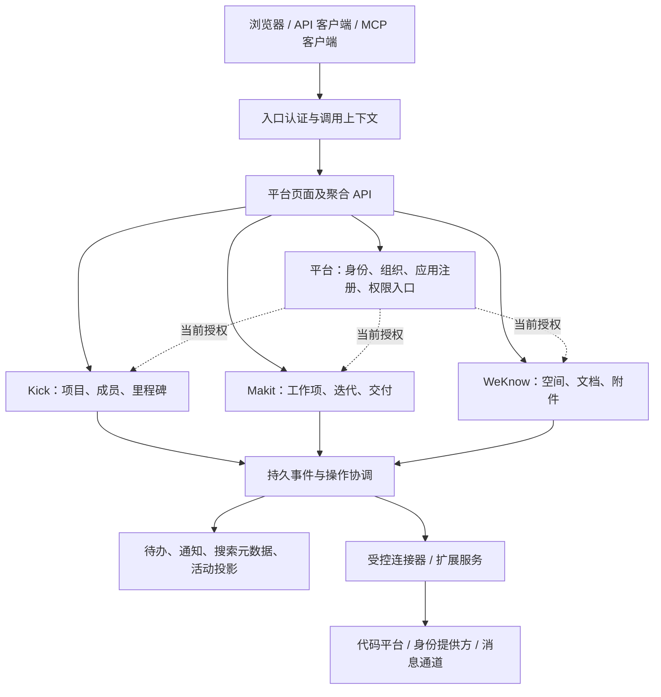

# CoBuild 协作框架改造方案

实施进度：[当前实施状态与待办](STATUS.md)，最新为 [第七批项目负责人转让](IMPLEMENTATION-07.md)。本文件保留整体目标和最初审查基线；不能将下方基线表当作当前尚未完成的清单。

状态：已进入分批实施，整体尚未完成。版本：RFC 0.1。方案日期：2026-10-28；首批实施记录：2026-10-29。

审查基线：`bc20bb2` / `0.6.0-dev.0`，范围为本地自部署套件。没有把实验室线上版的能力直接计入通用版，也没有改变现网、原始工程或当前发行门禁。

本文是方案入口。详细依据见 [项目参考研究](RESEARCH.md)，技术边界见 [扩展与服务契约](CONTRACTS.md)，实施与验收见 [实施计划](DELIVERY.md)，已做的自审见 [设计复核](REVIEW.md)。

## 1. 产品目标与范围

CoBuild 定位为：**以项目为主线、可自部署、可扩展的研发协作平台**。第一阶段服务一个组织，不引入 SaaS 多租户计费或跨组织共享。小型研发团队是首批使用对象；支持多少成员、多少并发必须通过容量测试确定。

用户应能在一个连续的工作环境中完成：

> 提出问题 → 明确目标和方案 → 计划需求 → 开发与评审 → 测试和发布 → 验收 → 沉淀知识。

### 1.1 做哪些产品

| 层级 | 内容 | 产品责任 |
| --- | --- | --- |
| 平台基础 | 身份、组织、权限、工作台、搜索、待办、通知、扩展管理 | 让应用共享能力，保留业务授权边界 |
| Kick | 项目、目标、成员、里程碑、立项规则、项目生命周期 | 项目唯一权威来源 |
| Makit | 工作项、需求、缺陷、迭代、交付、验收 | 研发工作的事实和流转 |
| WeKnow | 空间、文档、附件、知识模板、决策记录 | 内容及内容权限的权威来源 |
| 可选连接器 | GitHub 优先，后续 GitLab / Forgejo；OIDC、飞书、邮件、Webhook、AI | 对接部署者自己的服务 |
| 管理能力 | 审计、执行记录、备份、升级、健康、连接器状态 | 管理员按需进入，不占普通成员主导航 |

**明确不做：HiFlow、Evalab、荣誉、财务、考勤、通用聊天和大型低代码平台。** 这次范围约束优先于旧架构文件中的可选业务列表。它不授权删除原工程、生产资料或已有用户数据。

Relay 本轮不作为聊天产品发展；将来可以通过反馈连接器把明确选择的问题转成工作项。动态发布、公共邮箱完整客户端不纳入核心。邮箱保留为通知通道，Pulse 的合适能力归入管理控制台。桌面插件、品牌首页、独立催办工程和批改系统继续不纳入本仓库发行范围。

### 1.2 可扩展的定义

扩展性不是“可以随意往核心里放代码”。本方案要求：

1. 接入一个新连接器，不改 Kick / Makit / WeKnow 的业务实现。
2. 接入一种新资源，可以声明搜索、关联、待办、通知和权限，不给平台增加大量按应用名分支。
3. 升级、停用或故障时，边界明确，已有数据可恢复。
4. 一个扩展能声明自身不足，平台不把“不支持”显示为“成功”。
5. 用独立示例扩展与契约测试证明上述能力，不能只靠架构图宣称已经实现。

## 2. 基线审查：已有能力与差距

| 项目 | 当前核实到的能力 | 本次设计需要补齐 |
| --- | --- | --- |
| 独立身份 | 本地邀请账号、恢复、所有权转让、统一退出、三个应用会话 | OIDC、组织组同步契约、管理权限解释、接入诊断 |
| 项目关联 | 稳定项目 UUID、审批、Makit 投影、WeKnow 建空间回执 | 改名、归档、成员变化、私有项目全链路与历史映射 |
| 服务通信 | 独立服务密钥、HMAC、时间窗、业务请求幂等 | 版本化契约、持久防重、用途限定、统一错误与操作查询 |
| 模块控制 | 已有页面 / API / MCP / worker 门禁，启动时配置 | 去掉零散硬编码注册，定义启停生命周期和兼容性 |
| 需求与交付 | 已有需求、迭代、评论、验收、GitHub 和通知相关源码 | 通用运行器尚拒绝外部集成，需要实际适配和交付验收 |
| 效率分析 | 已有阶段耗时、阻塞、评审等待、数据完整性等模型 | 统一口径、项目视图、基于真实使用的改进验证 |
| 知识空间 | 可自动创建、保存明确 ID、避免重复创建 | 新项目的受管空间权限；当前默认全员可读写不能冒充私有空间 |
| 部署恢复 | 已有隔离容器、冷备份、受控增量迁移、HTTPS 会话验证 | 新环境运输、x86_64、平台 / WeKnow 迁移、公网与容量验证 |

来源：[当前运行说明](../../LOCAL-RUNTIME.md)、[现有架构](../../ARCHITECTURE.md)、[路线图](../../ROADMAP.md)、[发行阻塞](../../../release-blockers.json)。源码定位列于 [实施计划](DELIVERY.md)。

重要区别：当前三个业务服务在默认部署中仍由一个 `core` 容器运行。服务逻辑边界和容器数量不是同一件事。本方案不为了扩展性立即拆出更多运行组件。

## 3. 借鉴方向与取舍

| 参考对象 | 采用的思路 | 在 CoBuild 中的落点 |
| --- | --- | --- |
| Backstage | 核心、部署实例和插件分层；资源权限与搜索接口 | 扩展清单、资源引用、统一能力接口 |
| Plane | 围绕项目组织工作项、周期、模块、页面 | 项目工作空间和保持上下文的导航 |
| OpenProject | 类型、角色与状态转换；依赖关系 | 可配置工作流、阻塞关系、模板 |
| GitLab | 发布版本承载代码、文档和交付证据 | 区分合并、构建、部署、验收，保留证据快照 |
| Forgejo | 面向自托管代码平台的 Webhook 集成 | Git 提供方接口，不把 GitHub 字段写进核心模型 |
| Docmost | 空间、成员组、内容权限与导出 | 保留 WeKnow 内容服务边界，设计受管与既有空间两种关联 |
| Keycloak | 身份代理、账号关联和身份提供方配置 | 本地账号可用，OIDC 可选，内部稳定身份不依赖邮箱 |
| Temporal | 长任务状态、超时、重试与执行历史 | 有界持久流程；第一阶段不额外部署 Temporal |
| OpenTelemetry / CloudEvents | 可关联观测与标准事件信封 | 端到端操作定位与可版本化事件 |

这些是**理念和功能参考，不是整套引入方案**。具体官方链接、观察、版本和许可限制见 [研究记录](RESEARCH.md)。文档中存在某项功能，不代表它属于对应项目的免费开源版本。

## 4. 用户体验与信息架构

### 4.1 全局导航

普通成员主导航固定为：**我的工作、项目、知识**。全局搜索 / 命令入口放在统一导航中；收件箱显示需要关注的变化。自动化与连接器按权限放在管理区；高级视图按需出现。

“应用”保留在次级切换器，Kick / Makit / WeKnow 的名称和标识保留。默认不要求用户先决定该打开哪个应用才能完成一件事。

项目内导航：**概览、工作项、迭代、交付、知识、活动、设置**。未启用的能力不显示空页面；有权配置的负责人可看到单独的“添加能力”入口。项目设置中保留立项和成员管理，不再单独维护第二份项目档案。

### 4.2 我的工作

默认传统列表，支持保存视图；看板作为可选视图，不强迫使用。

| 分组 | 展示内容 | 操作 |
| --- | --- | --- |
| 待我处理 | 分配给我的工作项、评审、验收 | 打开原事项或执行有权的动作 |
| 等待他人 | 我负责但被依赖或审批阻塞的工作 | 查看阻塞原因与负责人 |
| 我关注的变化 | 被提及、订阅项目的重要变更 | 读后归档、取消订阅 |
| 最近工作 | 最近打开的项目和文档 | 快速继续，不复制业务数据 |

待办是原业务状态的投影。标记通知已读不等于完成任务；原事项完成后自动移出待处理。每项待办只有一个稳定来源引用，点击后保留当前项目和筛选。

### 4.3 项目概览

首屏只放目标、负责人、当前里程碑、待确认事项和明确阻塞；其次展示工作进展、近期交付和关键文档。项目健康度由可追溯事实产生，提供“为什么有风险”，不生成无法解释的总分。

项目创建默认只要求名称与负责人；模板、成员、可见性、文档空间和是否审批在同一流程渐进展开。模板可预览将创建的内容，失败后保留表单草稿及已成功的项目。

知识模板第一版提供：项目说明、需求说明、技术方案、决策记录、发布说明、复盘。它们由 WeKnow 保存，Kick / Makit 只保存资源引用与关系。

### 4.4 交互规范

- 只保留一层主标题与一致的面包屑，避免在应用外再叠加重复页头。
- 列表筛选写入 URL；返回页面保留筛选、排序、分页和滚动位置。区分“没有数据”“筛选无结果”“加载失败”。
- 表格列、表单校验、按钮层级、弹窗、抽屉、时间显示统一；新增页面先使用共享规范，老页面逐步替换。
- 大表单使用页内或侧栏编辑，必要时固定操作区；不会因为后台刷新关闭编辑器或预览。
- 自动保存显示“保存中 / 已保存 / 保存失败”，冲突提供对比和重新加载，不静默覆盖。
- 重要操作在原位置反馈结果；连接故障给出可执行恢复动作，技术详情只在诊断区出现。
- 删除无助于决策的浅灰提示；保留权限、数据影响、必填格式等必要信息。
- 提供完整键盘路径、可见焦点、读屏标签和移动端单列布局。以 [WCAG 2.2 AA](https://www.w3.org/TR/WCAG22/) 为验收目标，普通文本对比度至少 4.5:1；不把自动扫描通过当成完整无障碍验收。

### 4.5 前端整合路径

先共享设计令牌、交互规范、资源链接和类型化 API 客户端。现有 React / Vue / 原生页面继续运行，不进行一次性重写。

项目概览、我的工作、搜索使用平台自己的组件和聚合 API；专业编辑器仍由原应用负责。通过稳定深链进入 Makit / WeKnow 时携带项目上下文，各应用渲染同一导航规范。保持三应用现有独立源与 host-only 会话，不为统一外观改成共享宽域 Cookie。

不依赖 iframe 完成核心认证或全站整合。第三方扩展第一版只能贡献受控卡片、列表和跳转入口，不能在工作台源下运行任意远程脚本。跨框架视觉一致由令牌和验收保证，不通过强制迁移框架保证。

## 5. 总体架构

图中的框表示逻辑模块，不要求每框单独部署。默认继续使用现有平台服务、Makit、WeKnow、PostgreSQL / SQLite、Redis 和入口代理。无需新增 Kafka、Elasticsearch、图数据库、Kubernetes 或完整工作流平台。是否拆进程由资源、隔离与恢复测试决定。

同步 API 负责查询、命令接收及授权；事件负责传播已经提交的事实；持久操作负责跨应用步骤。业务真相在原服务中，聚合视图允许延迟并显示同步状态，不能反过来授权或覆盖原服务。

## 6. 数据与权限模型

### 6.1 数据归属

| 数据 | 唯一写入权威 | 其他组件如何使用 |
| --- | --- | --- |
| 组织、用户、组、身份绑定、会话 | Platform | 目录查询和实时授权接口 |
| 项目、项目角色、目标、里程碑 | Kick | 稳定 UUID + revision 投影；写操作调用 Kick |
| 工作项、迭代、代码关联、交付与验收 | Makit | 资源引用、事件、查询接口 |
| 空间、页面、附件、原生内容权限 | WeKnow | 权限过滤后的查询、明确空间绑定 |
| 连接器安装、范围和密钥引用 | Platform 集成管理 | 连接器只取自己获准的凭据 |
| 聚合待办、活动、搜索元数据 | 平台投影 | 可从来源重建，不成为业务主表 |
| 通知偏好、阅读和延后状态 | 平台通知模块 | 单独持久化；投影重建不能抹掉 |

统一 `ResourceRef` 表示资源身份，统一 `Relation` 表示关系。关系必须有明确类型和创建者；删除关系不删除目标。一个工作项可以关联多个文档、PR 和交付，不以标题、名称或 URL 文本匹配冒充身份。

不建立统一的“万能业务表”。数据库之间不做跨域写入；也不因为统一导航就把 WeKnow 正文复制到平台。

### 6.2 权限层次

有效访问需同时通过：**组织成员有效 → 应用已启用且获准进入 → 资源范围允许 → 业务角色允许此动作**。命令执行和异步重试时重新检查；服务签名、事件和 MCP scope 都不能代替业务授权。

组织所有者 / 管理员负责组织配置、连接器和治理，不默认读写所有私有项目文档。已有管理员权限在迁移阶段保留并显式映射，不静默收回，也不自动扩大。紧急访问采用有原因、限时、可审计的管理员操作，并在实现阶段单独验收。

项目默认角色为负责人、维护者、参与者、观察者；对应权限矩阵是默认值，可配置，但关键所有权和平台管理权限不可通过项目模板提升。

| 动作 | 建议默认有权角色 | 限制 |
| --- | --- | --- |
| 安装连接器、调整组织成员 | 组织所有者 / 管理员 | 不因此取得全部项目正文访问 |
| 修改项目成员和可见性 | 项目负责人 | 转让负责人需要接收人确认 |
| 管理工作项与迭代 | 负责人 / 维护者 | 参与者只能在获准范围执行工作流动作 |
| 提交工作进展、评论、编辑文档 | 参与者及以上 | 文档还需 WeKnow 原生写权限 |
| 读取项目 | 观察者及以上 | 特殊受限资源仍单独检查 |
| 立项审批 | 模板指定的审批角色 | 审批任务只授予必要申请信息访问，不自动开放全部项目文档 |

项目的流程审批人与业务验收人显式指定；组织管理员不能仅凭管理身份冒充已完成业务验收。

### 6.3 项目与知识空间的访问方式

| 方式 | 建议用途 | 权限语义 |
| --- | --- | --- |
| `project_managed` | 新建项目专属空间 | 项目资格与 WeKnow 原生权限取交集，项目移除成员能阻断直接页面、搜索、附件与协作连接 |
| `linked_existing` | 关联已有团队 / 公共空间 | 不自动改变空间权限；拥有项目访问权不意味着能查看空间 |
| `legacy_shared` | 保留旧项目的全员空间 | 保持原规则，显示实际范围；改成受管空间必须先预览影响并由有权管理员执行 |

新建专属空间默认项目成员范围，可显式选择组织范围共享。**这只是新部署 / 新项目的建议默认值，不自动改变现有全员可读写空间。** 受管空间必须在创建事务中设置正确权限，再返回空间；不可先按 Everyone 可写创建，稍后再收窄。

受管空间的入口守卫必须覆盖原生 API、搜索、下载和长连接。项目资格不能依赖异步目录快照；撤销时通过当前策略版本阻止旧授权继续使用。存量直连长连接需要撤销事件及续约检查。已经被合法下载的内容无法追溯收回，界面与文档应清楚说明。

敏感附件默认走带当前授权的下载代理；不生成可长期绕过撤权的公开链接。若后续引入对象存储直链，需明确有效期和撤销限制，并作为独立验收项。

第一版一个受管空间只归属一个项目；跨项目共用空间使用 `linked_existing`，避免成员集合合并导致越权。管理员手工修改 WeKnow 原生角色只能在受管约束内缩小或分配权限，不能绕过项目资格扩大访问。

## 7. 完整项目协作流程

1. **发起**：选择项目模板、填写目标、负责人和可见性；审批可以关闭或启用。模板版本固定在项目上，不受后续模板改动隐式影响。
2. **初始化**：审批通过或无需审批时，Kick 一次提交项目及 outbox。异步准备 Makit 项目投影、WeKnow 空间和模板文档。界面逐项显示就绪、进行中、失败；已成功步骤不回滚删除。
3. **计划**：将需求拆成工作项，设置验收标准、依赖和里程碑；需求及缺陷共享基础结构，保留类型特有字段。迭代与发布版本分开管理。
4. **开发**：工作项显式关联仓库和 PR / MR。系统通过事件及核对任务更新状态，显示来源与最后核验时间。
5. **交付**：Makit 的 Delivery 保存提交版本、构建结果、测试证据、目标环境、部署结果和验收记录。不能用“PR 已合并”直接宣告“已上线”。
6. **验收**：有权验收人检查固定的交付版本并确认；提交或部署版本变化后旧验收不自动覆盖新版本。
7. **沉淀**：从验收后的事实生成发布说明草稿、链接到 WeKnow；负责人确认后发布。设计决策保留状态、替代关系和原文版本。
8. **归档**：Kick 先进入受限状态并提升项目策略版本，拒绝新业务写入与新外发；向依赖应用推进归档，显示未完成项。保留记录、文档和资源关联，不级联删除。

第一版连接代码平台只读取关联与交付证据，允许人工登记部署。自动合并、触发生产部署、创建外部仓库等写操作后续单独开放，具有独立权限和确认流程。

## 8. 搜索、通知、自动化与效率分析

### 8.1 搜索

第一版采用权限感知的联邦查询：平台并发调用各应用受控搜索接口，带真实用户上下文，在来源处过滤，再聚合。支持按项目、类型、负责人和更新时间筛选。

默认每来源有界超时，部分失败返回“该来源暂不可用”，不无限等待。跨来源排名属于粗排，不承诺统一全文相关性。结果数量只包含有权返回的内容，缓存按用户、权限版本和查询隔离。索引不能成为授权依据。

只有联邦查询的实测瓶颈明确后才引入集中全文索引；即便引入，返回摘要、附件片段和 AI 引用前仍需当前权限校验。按 provider 提供分页，不伪装拥有稳定的全局总数。

### 8.2 通知

分开保存业务待办、站内通知与外部投递。站内通知可用不应依赖飞书或邮件。外部通道缺失时直接显示未配置。

通知具备稳定去重键、合并窗口、订阅、免打扰和摘要；内容在发送前再次校验接收人权限。外发结果分为排队、已提交给提供方、确认失败和结果未知，不能把 SMTP 接收等同于最终到达收件箱。

### 8.3 轻量自动化

第一版只支持已注册的“事件 / 定时 → 条件 → 有限动作序列”。例：工作项进入待验收时创建验收待办；里程碑阻塞超过阈值时汇总给负责人；交付验收后生成发布说明草稿。

规则按项目或组织配置，提供停用、模拟运行、版本、执行历史和失败步骤重试。执行身份固定为获批的服务主体，范围限定；每一步重新授权。限制触发深度、执行次数、并发、时长和外发额度，阻止规则互相循环。

不支持任意脚本、SQL、自由网络调用、BPMN 编排画布或无限动态分支。借鉴 [Temporal 的持久流程思想](https://docs.temporal.io/workflows)，第一版沿用数据库持久任务；这不等于实现了 Temporal 的确定性重放或全部语义。

### 8.4 效率分析

复用 Makit 已有模型，优先展示完成周期、阶段等待、阻塞、返工和范围变化。每个图能点到原事项与事件，显示时间口径、缺失数据和取消项处理。

项目目标与“成功标准”保留在 Kick；指标用于讨论过程改进。第一版不做个人产出排名、工时监控或复杂 OKR 产品。AI 可以辅助归纳有权读取的事实，不能替代证据或自动变更权限。

## 9. 身份、连接器与 AI / MCP

保留独立本地邀请账号；OIDC 作为首个通用企业身份连接，飞书作为可选适配。平台在此是外部 IdP 的客户端，不把当前私有单次代码桥接协议宣传为通用 OIDC 服务端。

内部用户 ID 不变；外部身份以 `issuer + subject` 识别，关联既有账号必须本人确认。组同步明确来源、映射、增量 / 全量完成标记、删除语义和异常恢复；一次失败或不完整分页不能清空组织。OIDC 登录本身不承诺实时离职同步，禁用时效通过明确的目录适配 / 撤销机制验收。参考 [OIDC 标准](https://openid.net/specs/openid-connect-core-1_0.html) 与 [Keycloak 身份代理](https://www.keycloak.org/docs/latest/server_admin/)。

本地账号安全后续增加 MFA；OIDC 部署优先由 IdP 强制 MFA。恢复、所有权转让、连接器凭据管理继续要求重新确认身份，不能由普通会话静默完成。

连接器配置有测试连接、所需权限、授权范围、最后成功时间、失效原因、重新授权和停用。凭据只在后端引用私有存储；首次安装不申请无关权限。

API、网页和 MCP 调用相同的业务命令处理器。AI / MCP 属于入口，不能直接操作数据库。可写动作返回预览、目标、预期版本和可追踪操作 ID；发布、外发等动作按策略确认。AI 输出默认草稿，提示词和文档都不是授权；外部模型默认关闭，并显示数据边界和使用费用。

## 10. 部署、升级与开源发行

默认仍为单组织 Compose；逻辑模块独立不要求微服务化。保留已验收的最小部署路径，正式发行优先打通同架构新机器恢复及 x86_64 构建；目标配置不能依赖实验室域名或校园网络。

扩展与核心均进入 release manifest：记录代码 / 镜像版本、契约版本、配置版本、schema、附件格式、备份格式和兼容矩阵。扩展新增结构必须在自己的存储中执行有界迁移，不能附带任意核心 SQL。

恢复先在隔离目标中默认关闭外发和定时外部动作，核对待执行任务与已经提交给外部的动作后，再显式恢复消费。备份清单不仅记录数据，还记录是否存在跨服务未完成操作；不能用旧快照覆盖升级后的新写入来“回滚”。

保留上游许可和来源记录。WeKnow 的派生许可、现有源码权属、第三方素材和依赖审查继续作为发行门禁；本方案没有确认所有参考项目的功能均可复用，也没有给整个套件重新授权。

管理控制台集中提供成员 / 权限、连接器、规则执行、审计、存储与备份状态。审计记录操作者、动作、对象、结果、关联 ID 和安全的差异摘要，避免记录凭据及整篇私有内容；常规追加日志不能宣称不可篡改，必要时允许导出到部署者的独立审计系统。

业务导出与灾难备份分开：项目可导出结构化 JSON / CSV、关系映射和有权文档的 Markdown / 附件；全实例备份需要管理员权限并覆盖密钥。业务资料、通知、日志和已完成任务分别配置保留期，清理前预览影响并保留副作用防重所需的回执。首版不承诺无条件永久保留，也不自动删除旧业务资料。

## 11. 实施顺序与成功标准

| 阶段 | 用户可见成果 | 必须通过的关口 |
| --- | --- | --- |
| D0 范围与可信基线 | 新发行只包含核心范围；现有能力不退化 | 排除模块依赖审计、镜像 / 备份运输、独立恢复、许可清单 |
| D1 契约与项目生命周期 | 项目改名、成员变更、归档和空间权限一致 | 核心应用作为首批扩展适配；事务 outbox；重复 / 乱序 / 撤权测试 |
| D2 连贯工作体验 | 项目工作空间、我的工作、权限过滤搜索、站内通知 | 无重复页头；筛选可恢复；局部故障；键盘和真实浏览器流程 |
| D3 真实交付 | GitHub 关联、评审 / 测试 / 部署证据、版本验收 | 测试仓库全链路；Webhook 去重核验；合并与上线分离 |
| D4 团队自适应 | OIDC、模板、轻量自动化和连接器管理 | 实例模板固定版本；规则模拟；组同步异常；受限执行身份 |
| D5 开发者与外部试点 | SDK、示例扩展、文档、完整发行候选 | 独立扩展不改核心；干净环境安装；真实外部团队试用 |

不是把所有 D0 工程做完才开始产品改造：跨机器验证和许可审查可与 D1 的本地契约设计并行推进；但任一阶段缺少安全 / 数据关口时不能宣称可正式发行。

三个关键验收场景：

1. **团队用户**：首次登录后创建项目，安排需求、写方案、关联 PR、核验测试、记录部署、验收并沉淀发布说明；无需重复录入项目或创建多份账号。
2. **部署管理员**：在另一台受支持机器安装并恢复备份；权限、链接、文档附件和进行中的操作正确，恢复不误发消息。
3. **扩展开发者**：只用公开契约添加一个检查结果扩展，展示项目卡片、搜索和待办；停用后所有入口和任务停止，重新启用后原数据还在，未修改核心实现。

各阶段具体测试编号、改造文件、回退条件和范围见 [实施与验收计划](DELIVERY.md)。

## 12. 暂缓的技术选择与已知风险

- 不先搭插件市场、全套微前端、统一图数据库或通用流程引擎。通过一个独立扩展示例验证接口后再扩宽。
- 不急于迁移所有 SQLite 到 PostgreSQL；先确认事务边界、备份与多进程限制。默认单平台写实例，水平扩容不是第一版承诺。
- 不一次性重写所有前端。短期的代价是维护三套组件适配，收益是降低业务回归与编辑器替换风险。
- 权限同步、搜索摘要和直接下载是高风险组合，应在便利的聚合界面之前补齐源服务授权。
- 工作流、事件和权限的接口一旦开放，兼容成本长期存在；先发布 alpha 契约、明确支持矩阵，达到验收后才承诺稳定 v1。
- 该方案提出的是目标，不能提前保证“优秀扩展性”。扩展示例、恢复演练和外部团队试用是检验依据。

本次只形成设计文档，没有实施业务重构、启停服务、外发消息、调整权限或公开发布。
